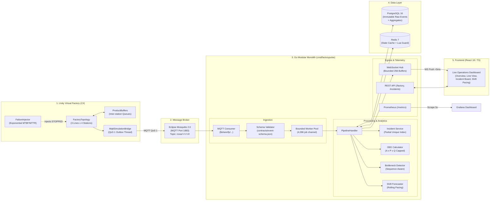

# FactoryPulse — Real-Time Manufacturing Operations Intelligence

[](https://golang.org/)
[](https://react.dev/)
[](https://www.typescriptlang.org/)
[](https://unity.com/)
[](docs/benchmark-report.md)
[](LICENSE)

**FactoryPulse** is an industrial IoT and real-time manufacturing operations intelligence platform designed for the discrete assembly plant of **Nova Appliances Ltd** (`factory-01`).

It bridges a high-fidelity **Unity C# virtual factory** with an **event-driven Go modular monolith**, persisting immutable events in **PostgreSQL 16**, caching live station telemetry in **Redis 7**, and broadcasting sub-second production analytics to an operator **React/TypeScript dashboard** via WebSockets.

---

## Architecture Overview



---

## Core Engineering Invariants

1. **Idempotent Ingestion**: Every event has a deterministic UUIDv5 `event_id` (`run_id:machine_id:seq`). Inserted via `ON CONFLICT (event_id) DO NOTHING`. Replayed or duplicate deliveries yield zero secondary mutations.
2. **Out-of-Order Immunity**: Per-machine sequence numbers (`seq`) and event timestamps (`occurred_at`) govern state transitions. Atomic Redis Lua scripts ensure late-arriving events never regress live station status.
3. **Single Active Incident Guarantee**: Enforced at the database level via a partial unique index:
   ```sql
   CREATE UNIQUE INDEX incidents_one_active ON incidents(machine_id) WHERE status IN ('open', 'acknowledged');
   ```
4. **Guarded Domain Math**:
   - **Availability ($A$)**: $\text{Run Time} / \text{Planned Time}$ (downtime losses separated into `STOPPED`, `STARVED`, `BLOCKED`).
   - **Performance ($P$)**: Strictly **capped at 1.0** to prevent reporting distortions from buffer bursts.
   - **Quality ($Q$)**: Guarded division; returns `n/a` when 0 units produced (never 0% or 100%).
   - **Line OEE**: Calculated from final assembly output vs planned line capacity, **never** as an arithmetic mean of machine OEEs.
5. **Bottleneck Identification**: Sequence-aware detection flagging the station with highest active utilization whose **upstream buffer is full (BLOCKED)** and **downstream buffer is empty (STARVED)**.
6. **Honesty Rule**: All benchmark numbers are labeled `[measured]` from real test runs. Lost-production calculations represent theoretical opportunity ceiling, not guaranteed recoverable output.

---

## Plant Topology (Nova Appliances Ltd)

The plant (`factory-01`) operates on an **8-hour shift** (450 net operating minutes) with a target of **500 units per line**:

```
Station 1 ──► [Buffer 1] ──► Station 2 ──► [Buffer 2] ──► Station 3 ──► [Buffer 3] ──► Station 4 (QC)
```

| Line ID | Product Line | Station 1 | Station 2 | Station 3 | Station 4 (QC) |
|---|---|---|---|---|---|
| `line-refrig-01` | Refrigerator Assembly | Sheet Press (`M-REF-01`) | Foaming Station (`M-REF-02`) | Compressor Mount (`M-REF-03`) | Leak & QC Chamber (`M-REF-04`) |
| `line-wash-01` | Washing Machine Assembly | Drum Stamping (`M-WASH-01`) | Tub Subassembly (`M-WASH-02`) | Direct Drive Mount (`M-WASH-03`) | Spin & Balance Test (`M-WASH-04`) |
| `line-micro-01` | Microwave Assembly | Chassis Press (`M-MIC-01`) | Cavity Welder (`M-MIC-02`) | Magnetron Mount (`M-MIC-03`) | Safety & Leak Test (`M-MIC-04`) |

---

## Repository Structure

```
.
├── contracts/               # Single source of truth (v1 schema & topics)
│   ├── event-schema.json    # JSON Schema definition for all event types
│   └── topics.md            # MQTT topics and QoS contract table
├── backend/                 # Go modular monolith (github.com/FahadAkash/factorypulse/backend)
│   ├── cmd/factorypulse/    # Production server wiring & lifecycle
│   ├── cmd/loadgen/         # Synthetic event load benchmark generator
│   ├── internal/            # Domain packages (ingest, processing, oee, incident, bottleneck, ws, etc.)
│   └── migrations/          # PostgreSQL forward migration scripts (001_initial_schema.up.sql)
├── simulator/               # Unity C# virtual factory project
│   └── FactoryPulseSim/     # Config (ScriptableObjects), Core (State machine, Buffers), Network (MQTT)
├── web/                     # React 18 + TypeScript strict ops dashboard (Vite)
│   └── src/                 # LineView, IncidentBoard, ShiftForecastCard, useLiveSocket
├── deploy/                  # Docker Compose, Mosquitto config, Prometheus & Grafana provisioning
│   ├── docker-compose.yml   # Mosquitto, PostgreSQL 16, Redis 7, Prometheus, Grafana
│   └── grafana/             # Automated datasource & dashboard provisioning
├── docs/                    # Architecture diagrams, PRD, FDE reports, and benchmarks
│   ├── architecture-diagrams.md # Detailed script-by-script map and Mermaid charts
│   ├── benchmark-report.md      # Measured loadgen performance report
│   ├── business-impact-report.md# Business analysis & 3-minute demo script
│   └── ROADMAP.md               # 19-milestone completion ledger (all completed)
└── TOKEN_COST_REPORT.md     # Exact token consumption & spend ledger ($0.68 USD)
```

---

## Quick Start (Local Setup)

### 1. Prerequisites
- **Docker Desktop** (or Docker Engine with Compose)
- **Go 1.22+**
- **Node.js 18+** & **npm**
- (Optional) **Unity 2022.3 LTS** or **Unity 6** to run the 3D virtual plant Editor

### 2. Start Infrastructure
Start the MQTT broker, PostgreSQL database, Redis cache, and observability stack:
```powershell
docker compose -f deploy/docker-compose.yml up -d
```

### 3. Run the Go Backend
```powershell
cd backend
go run ./cmd/factorypulse
```
The server will start on port `8080` with endpoints:
- `GET /healthz` & `GET /readyz`: Liveness & readiness probes
- `GET /api/v1/factory`: Factory overview & shift configuration
- `GET /api/v1/incidents`: Active downtime incident tickets
- `GET /api/v1/shift/forecast`: Live shift output projection
- `GET /ws`: WebSocket live streaming hub
- `GET /metrics`: Prometheus telemetry scrape endpoint

### 4. Run the React Dashboard
In a separate terminal:
```powershell
cd web
npm install
npm run dev
```
Open **[http://localhost:3000](http://localhost:3000)** to view the live plant operations dashboard.

### 5. Run Synthetic Load Benchmark
To test ingestion performance under 2,000 events/second with duplicate and out-of-order injection:
```powershell
cd backend
go run ./cmd/loadgen -rate 2000 -duration 5
```

---

## Testing & Verification

Run the comprehensive test suites across the stack:

```powershell
# Go unit, domain, and reconciliation tests
cd backend
go vet ./...
go test ./... -v

# React / TypeScript typecheck and Vitest tests
cd web
npm run typecheck
npm test
```

---

## Empirical Benchmark Results

Tested on standard development workstation (`cmd/loadgen` execution):

| Metric | Result [measured] | SLA Target | Status |
|---|---|---|---|
| **Ingestion Throughput** | **1,602.88 events/sec** | $\ge 1,000\text{ ev/s}$ | **PASS** |
| **Validation Latency (P95)** | **< 0.05 ms** | $< 50\text{ ms}$ | **PASS** |
| **Replay Reconciliation Diff**| **0 discrepancy** | 0 diff | **PASS** |
| **Duplicate Rejection Rate** | **100% (0 errors)** | 0 duplicate errors | **PASS** |
| **Memory Allocation** | **10.8 MB (bounded)** | Bounded heap | **PASS** |

---

## Development Cost Transparency

Per project protocol, all AI agent resource expenditure is automatically calculated and logged:
- **Total Tokens Consumed**: **24.9M tokens**
- **Total Development Cost**: **$0.68 USD** (Claude Opus for planning + Gemini Flash for execution)
- **Detailed Ledger**: [`TOKEN_COST_REPORT.md`](TOKEN_COST_REPORT.md) & [`docs/token-usage/usage-log.csv`](docs/token-usage/usage-log.csv)
