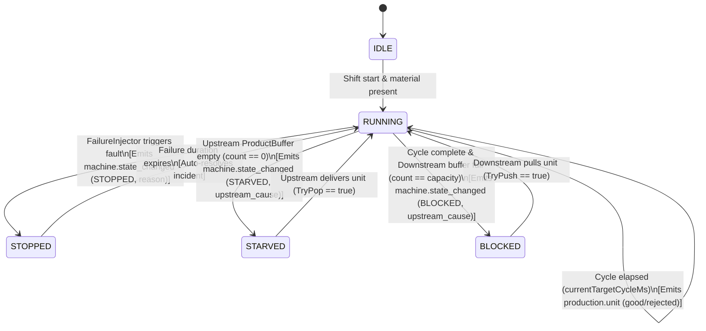
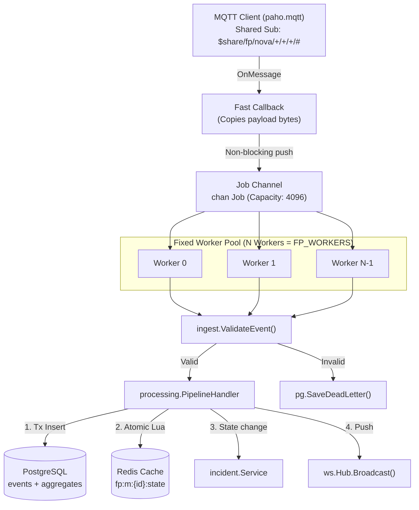
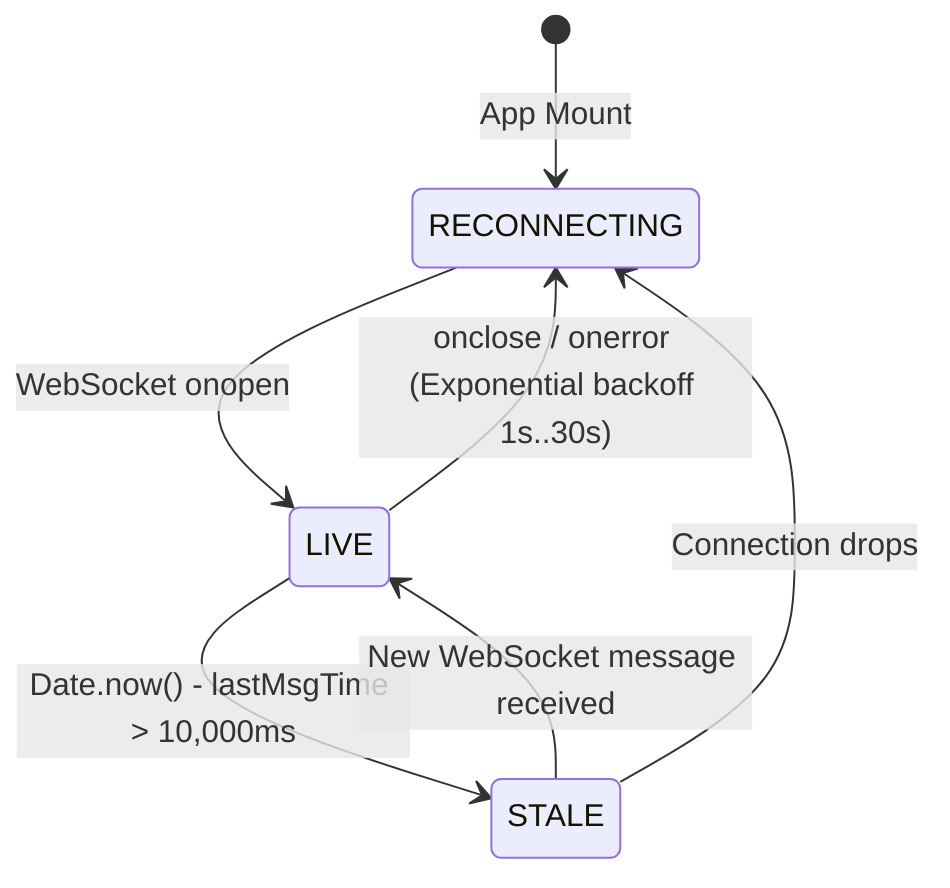

# FactoryPulse — Low-Level Design (LLD)

> **Document Version**: 1.0.0  
> **Target System**: FactoryPulse Real-Time Operations Intelligence  
> **Scope**: Component Internals, Struct Layouts, Algorithms, State Machines & Concurrency Models

---

## 1. Introduction & Design Principles

The Low-Level Design (LLD) defines the internal implementation specifications of FactoryPulse:
- **Modular Monolith in Go**: Strict domain encapsulation under `internal/`, inward-only dependencies, zero global state.
- **Contract-First Stream Processing**: Strict JSON Schema validation on ingest against `contracts/event-schema.json`.
- **Idempotent Ingestion**: UUIDv5 deduplication (`run_id:machine_id:seq`) with single-transaction persistence and aggregation.
- **Bounded Concurrency**: Bounded channels, fixed worker pools, and zero dynamic per-message goroutine spawning.
- **Deterministic Simulation**: Seeded random variables, decoupled discrete clock steps, and lock-free outbox queues in C#.

---

## 2. Unity Simulator Internal Design (C#)

### 2.1 State Machine: MachineNode
Each machine station transitions deterministically according to buffer levels, cycle progress, and injected faults.



### 2.2 Core Structs & Classes

#### `MachineNode` (`Assets/Scripts/Core/MachineNode.cs`)
```csharp
public class MachineNode : MonoBehaviour {
    // Configuration & Connections
    private MachineConfig config;
    private ProductBuffer upstreamBuffer;   // null for Station 1 (raw material)
    private ProductBuffer downstreamBuffer; // null for Station 4 (finished goods)
    
    // Runtime State
    private MachineOperationalState currentState;
    private string currentReasonCode;
    private string upstreamCauseMachineId;
    private long sequenceNumber;
    
    // Cycle Progress
    private bool hasWorkPiece;
    private float currentCycleElapsedMs;
    private float currentTargetCycleMs;
    private bool currentUnitIsGood;
    private string currentDefectCode;
    
    // Deterministic Engines
    private SimClock _clock;
    private FailureInjector _failureInjector;
    private System.Random _cycleRng;
    private ConcurrentQueue<SimEvent> _eventOutbox;
}
```

#### `FailureInjector` (`Assets/Scripts/Core/FailureInjector.cs`)
Implements inverse transform sampling on exponential distributions:
$$T_{\text{next}} = -\text{MTBF} \times \ln(1 - U), \quad D_{\text{repair}} = -\text{MTTR} \times \ln(1 - U) \quad (U \sim \text{Uniform}(0, 1))$$
Per-machine seed initialization: `machineSeed = Hash(masterSeed, machineId)`.

#### `ProductBuffer` (`Assets/Scripts/Core/ProductBuffer.cs`)
```csharp
public class ProductBuffer : MonoBehaviour {
    private string bufferId;
    private int capacity;
    private int currentCount;
    
    public bool TryPush() {
        if (currentCount >= capacity) return false;
        currentCount++;
        return true;
    }
    
    public bool TryPop() {
        if (currentCount <= 0) return false;
        currentCount--;
        return true;
    }
}
```

---

## 3. Go Backend Internal Design

### 3.1 Concurrency & Worker Pool Architecture



### 3.2 Ingestion & State Ordering Algorithm

#### Redis Lua Ordering Script (`internal/store/redis/state.go`)
Prevents out-of-order late events from regressing current machine state:
```lua
local current_seq = redis.call('HGET', KEYS[1], 'last_seq')
local current_at = redis.call('HGET', KEYS[1], 'last_at')

local new_seq = tonumber(ARGV[3])
local new_at = ARGV[4]

-- Reject update if new event has older or equal sequence and timestamp
if current_seq and tonumber(current_seq) then
    if new_seq <= tonumber(current_seq) and new_at <= current_at then
        return 0 -- Rejected (out-of-order)
    end
end

redis.call('HSET', KEYS[1],
    'state', ARGV[1],
    'reason', ARGV[2],
    'last_seq', ARGV[3],
    'last_at', ARGV[4],
    'since', ARGV[5]
)
return 1 -- Applied
```

---

## 4. Domain Algorithms & Calculations

### 4.1 Overall Equipment Effectiveness (OEE) (`internal/oee/calculator.go`)
$$\text{OEE} = \text{Availability} \times \text{Performance} \times \text{Quality}$$

1. **Availability ($A$)**:
   $$A = \frac{\text{RunTime}}{\text{PlannedTime} - \text{MaintenanceTime}}$$
   *Loss buckets tracked separately*: $\text{Loss}_{\text{stopped}}$, $\text{Loss}_{\text{starved}}$, $\text{Loss}_{\text{blocked}}$.

2. **Performance ($P$)**:
   $$P = \min\left(1.0, \frac{\text{TotalUnits} \times \text{IdealCycleMs} / 1000.0}{\text{RunTimeSeconds}}\right)$$
   *Design guard*: Strictly clamped to $1.0$ to eliminate artificial surges from buffer bursts.

3. **Quality ($Q$)**:
   $$Q = \begin{cases} \frac{\text{GoodUnits}}{\text{TotalUnits}}, & \text{if } \text{TotalUnits} > 0 \\ \text{nil (rendered as \"n/a\")}, & \text{if } \text{TotalUnits} == 0 \end{cases}$$

4. **Line-Level OEE Rule**:
   $$\text{Line OEE} = A_{\text{line}} \times \left(\frac{\text{FinalStationGoodUnits}}{\text{PlannedLineCapacity}}\right) \times 1.0$$
   *Strictly derived from line finished goods, never an arithmetic average of individual station OEEs.*

---

### 4.2 Sequence-Aware Bottleneck Detection (`internal/bottleneck/detector.go`)

Calculated across rolling window $W$ (e.g. 15 minutes) for station order $i \in [1 \dots 4]$:
$$\text{Score}_i = \text{Util}_i \times \left(1.0 - 0.5 \times \frac{\text{Throughput}_i}{\text{Capacity}_i}\right) + \text{ConstraintBonus}$$

Where:
- $\text{ConstraintBonus} = +1.0$ if $\text{BlockedRatio}_{i-1} > 0.15$ **AND** $\text{StarvedRatio}_{i+1} > 0.15$
- $\text{ConstraintBonus} = +0.5$ if only upstream is blocked or only downstream is starved
- Active downtime intervals (`HasActiveDowntime == true`) are **excluded** (tracked as incidents, not constraints)
- **Persistence Filter**: Requires station to top the ranking across $\ge 3$ consecutive evaluation windows before raising a line bottleneck flag.

---

### 4.3 Shift Pacing & Forecasting (`internal/shift/forecast.go`)
$$\text{HoursLeft} = \max(0, \text{ShiftTotalHours} - \text{ShiftElapsedHours})$$
$$\text{RequiredRate} = \frac{\text{Target} - \text{Produced}}{\text{HoursLeft}}$$
$$\text{ProjectedTotal} = \text{Produced} + (\text{CurrentRollingHourlyRate} \times \text{HoursLeft})$$

Status thresholds:
- `INSUFFICIENT_DATA`: If $\text{ShiftElapsed} < 15\text{ minutes}$
- `ON_TRACK`: If $\text{ProjectedTotal} \ge \text{Target}$
- `AT_RISK`: If $0.90 \times \text{Target} \le \text{ProjectedTotal} < \text{Target}$
- `BEHIND`: If $\text{ProjectedTotal} < 0.90 \times \text{Target}$

---

## 5. Database Schema & Query Patterns (PostgreSQL 16)

### 5.1 Tables & Keys

```sql
-- 1. Immutable Event Ledger
CREATE TABLE events (
    event_id UUID PRIMARY KEY,
    factory_id TEXT NOT NULL,
    line_id TEXT NOT NULL,
    machine_id TEXT NOT NULL,
    run_id TEXT NOT NULL,
    event_type TEXT NOT NULL,
    seq BIGINT NOT NULL,
    occurred_at TIMESTAMPTZ NOT NULL,
    received_at TIMESTAMPTZ NOT NULL DEFAULT NOW(),
    trace_id TEXT,
    payload JSONB NOT NULL
);
CREATE INDEX idx_events_machine_occurred ON events(machine_id, occurred_at);

-- 2. Minute-Bucket Production Aggregation
CREATE TABLE production_minute (
    machine_id TEXT NOT NULL,
    bucket TIMESTAMPTZ NOT NULL,
    good INT NOT NULL DEFAULT 0,
    rejected INT NOT NULL DEFAULT 0,
    run_ms BIGINT NOT NULL DEFAULT 0,
    PRIMARY KEY (machine_id, bucket)
);

-- 3. Defect Classification Pareto
CREATE TABLE defects (
    machine_id TEXT NOT NULL,
    bucket TIMESTAMPTZ NOT NULL,
    defect_code TEXT NOT NULL,
    count INT NOT NULL DEFAULT 0,
    PRIMARY KEY (machine_id, bucket, defect_code)
);

-- 4. Downtime Incident Lifecycle with Partial Unique Index
CREATE TABLE incidents (
    id UUID PRIMARY KEY DEFAULT gen_random_uuid(),
    machine_id TEXT NOT NULL,
    status TEXT NOT NULL, -- 'open', 'acknowledged', 'resolved'
    opened_at TIMESTAMPTZ NOT NULL,
    acknowledged_at TIMESTAMPTZ,
    resolved_at TIMESTAMPTZ,
    assignee TEXT,
    root_cause TEXT,
    source_event_id TEXT NOT NULL
);
CREATE UNIQUE INDEX incidents_one_active 
ON incidents(machine_id) 
WHERE status IN ('open', 'acknowledged');
```

---

## 6. Real-Time Communication & APIs

### 6.1 WebSocket Hub Protocol (`internal/ws/hub.go`)

- **Connection**: `GET /ws` upgraded to WebSocket binary/text stream.
- **Client Buffer**: Dedicated `chan []byte` (capacity 256) per connected browser.
- **Slow Consumer Protection**: If client buffer fills, client is disconnected immediately; the hub broadcast loop never blocks.
- **Envelope Schema**:
```json
{
  "type": "machine_state | production_delta | incident | line_summary",
  "ts": "2026-11-06T15:40:00.000Z",
  "seq": 142,
  "data": { ... }
}
```

### 6.2 REST Endpoints (`internal/api/routes.go`)

| Method | Path | Request Body | Response Body | Description |
|---|---|---|---|---|
| `GET` | `/healthz` | None | `{"status":"UP","time":"..."}` | Liveness check |
| `GET` | `/readyz` | None | `{"status":"READY","time":"..."}` | Readiness check |
| `GET` | `/api/v1/factory` | None | Factory metadata & line summaries | Top-level factory overview |
| `GET` | `/api/v1/incidents` | None | `[{"id":"...","status":"open",...}]` | Active incident queue |
| `POST` | `/api/v1/incidents/{id}/acknowledge` | `{"assignee":"string"}` | `{"status":"acknowledged"}` | Technician ticket claim |
| `POST` | `/api/v1/incidents/{id}/resolve` | `{"root_cause":"string"}` | `{"status":"resolved"}` | Manual ticket closure |
| `GET` | `/api/v1/shift/forecast` | None | Forecast object with pacing | Live shift pacing projection |
| `GET` | `/metrics` | None | Prometheus text exposition | Scrape target for Prometheus |

---

## 7. Frontend Architecture (React 18 / TypeScript)

### 7.1 State & Connection Management (`src/hooks/useLiveSocket.ts`)



- **Resync on Reconnect**: On reconnection, the dashboard queries REST `/api/v1/factory` snapshot and applies streaming deltas ignoring stale `seq`.
- **Status Indicator**: The UI displays a persistent pill badge:
  - `LIVE` (Green pulse): Continuous telemetry streaming.
  - `RECONNECTING` (Amber): Network reconnection with backoff.
  - `STALE (>10s)` (Red): Connection established but no telemetry received for over 10 seconds.
