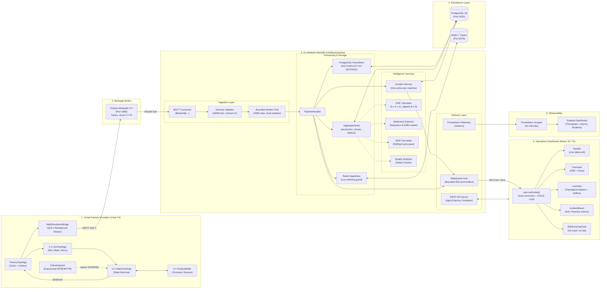
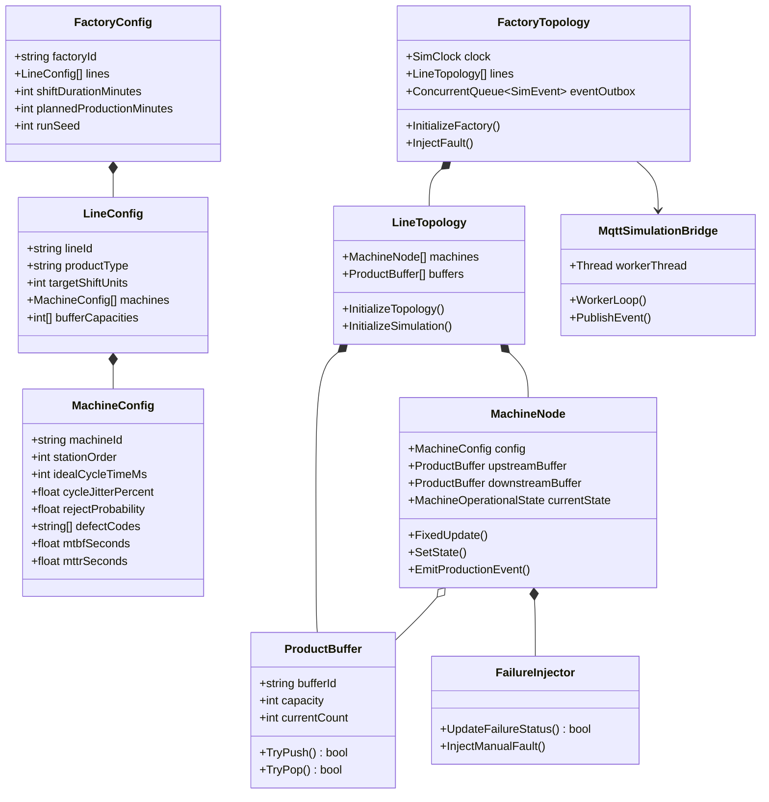
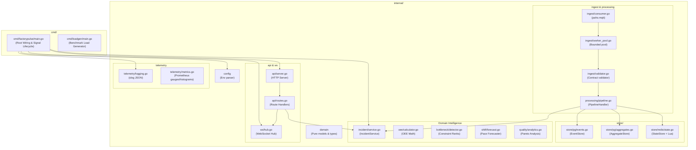
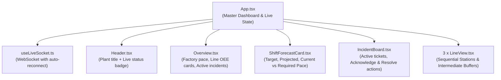
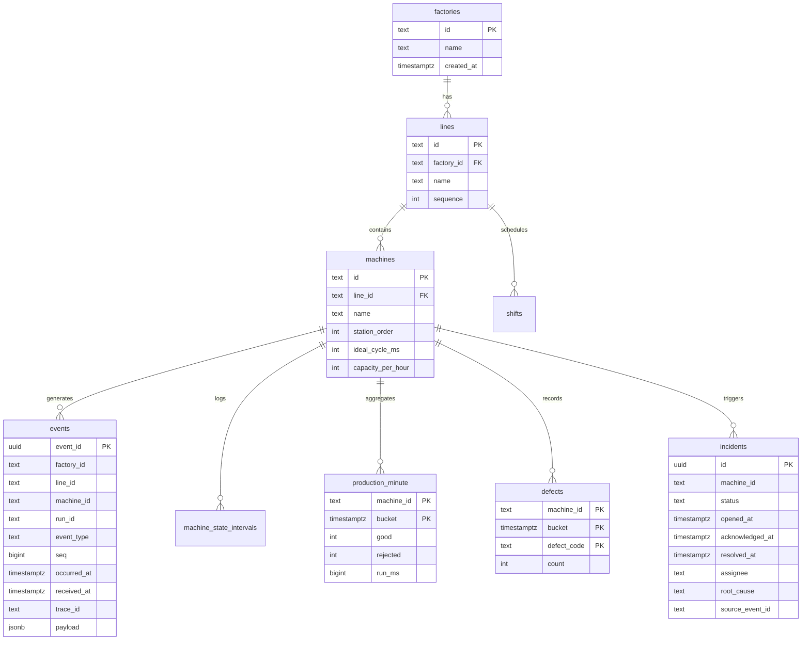
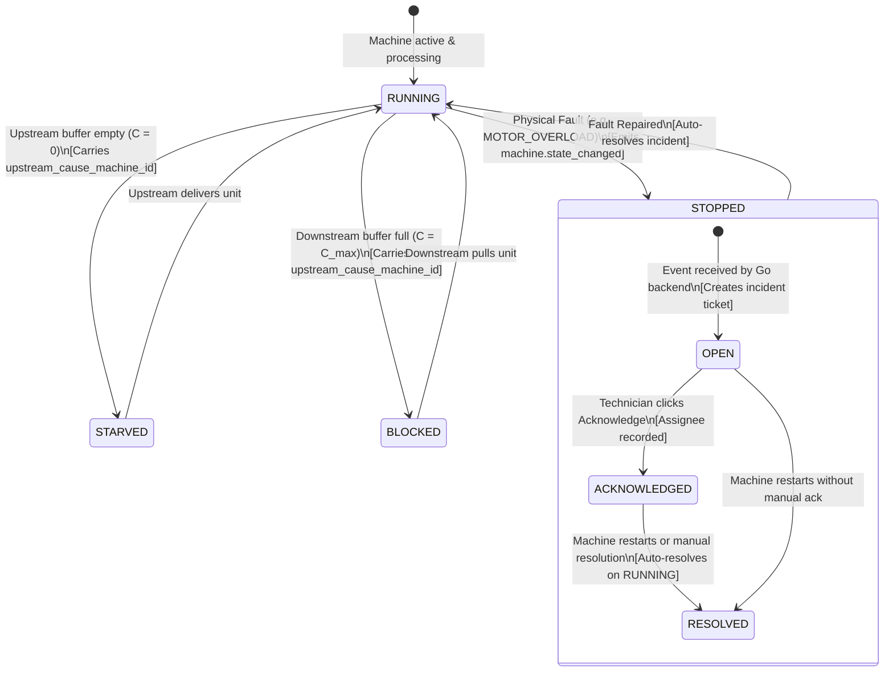

# FactoryPulse — Complete System Architecture & Script Map

This document provides a comprehensive visual and technical map of the entire FactoryPulse project, detailing every script, component, data pipeline, and database relationship.

---

## 1. High-Level End-to-End Pipeline

---

## 2. Unity Simulator: Architecture & Script Map

**Directory**: `simulator/FactoryPulseSim/Assets/Scripts/`  
**Assembly Definition**: `FactoryPulseSim.asmdef`

### Script Inventory (Simulator)

| Path | Primary Role |
|---|---|
| [`Config/MachineConfig.cs`](file:///F:/coding/_LinkdingProject/Episode2/FactoryPulse/simulator/FactoryPulseSim/Assets/Scripts/Config/MachineConfig.cs) | ScriptableObject defining station cycle time, jitter, defect probabilities, and MTBF/MTTR. |
| [`Config/LineConfig.cs`](file:///F:/coding/_LinkdingProject/Episode2/FactoryPulse/simulator/FactoryPulseSim/Assets/Scripts/Config/LineConfig.cs) | ScriptableObject holding 4 connected machines and 3 intermediate buffer capacities. |
| [`Config/FactoryConfig.cs`](file:///F:/coding/_LinkdingProject/Episode2/FactoryPulse/simulator/FactoryPulseSim/Assets/Scripts/Config/FactoryConfig.cs) | Master ScriptableObject holding 3 line configs, 8h shift params, and seed. |
| [`Core/ProductBuffer.cs`](file:///F:/coding/_LinkdingProject/Episode2/FactoryPulse/simulator/FactoryPulseSim/Assets/Scripts/Core/ProductBuffer.cs) | Inter-station queue managing `TryPush()` and `TryPop()` with starvation/blocking signals. |
| [`Core/MachineNode.cs`](file:///F:/coding/_LinkdingProject/Episode2/FactoryPulse/simulator/FactoryPulseSim/Assets/Scripts/Core/MachineNode.cs) | MonoBehaviour station executing deterministic unit cycles, failure checks, and event emission. |
| [`Core/LineTopology.cs`](file:///F:/coding/_LinkdingProject/Episode2/FactoryPulse/simulator/FactoryPulseSim/Assets/Scripts/Core/LineTopology.cs) | Wires 4 machines in series with 3 buffers: `M1 -> B1 -> M2 -> B2 -> M3 -> B3 -> M4`. |
| [`Core/FactoryTopology.cs`](file:///F:/coding/_LinkdingProject/Episode2/FactoryPulse/simulator/FactoryPulseSim/Assets/Scripts/Core/FactoryTopology.cs) | Root orchestrator managing master simulation clock and outbox queue. |
| [`Core/SimClock.cs`](file:///F:/coding/_LinkdingProject/Episode2/FactoryPulse/simulator/FactoryPulseSim/Assets/Scripts/Core/SimClock.cs) | Deterministic clock advancing by fixed delta with 1x to 60x timescale fast-forward. |
| [`Core/SimEvent.cs`](file:///F:/coding/_LinkdingProject/Episode2/FactoryPulse/simulator/FactoryPulseSim/Assets/Scripts/Core/SimEvent.cs) | Immutable struct envelope matching `contracts/event-schema.json`. |
| [`Core/FailureInjector.cs`](file:///F:/coding/_LinkdingProject/Episode2/FactoryPulse/simulator/FactoryPulseSim/Assets/Scripts/Core/FailureInjector.cs) | Generates exponential MTBF/MTTR distributions from seeded `System.Random`. |
| [`Network/MqttSimulationBridge.cs`](file:///F:/coding/_LinkdingProject/Episode2/FactoryPulse/simulator/FactoryPulseSim/Assets/Scripts/Network/MqttSimulationBridge.cs) | Background thread publisher draining outbox and logging to `runs/{runId}/events.jsonl`. |
| [`Analytics/GroundTruthRecorder.cs`](file:///F:/coding/_LinkdingProject/Episode2/FactoryPulse/simulator/FactoryPulseSim/Assets/Scripts/Analytics/GroundTruthRecorder.cs) | Writes `runs/{runId}/ground_truth.json` for validation and bottleneck checks. |
| [`Utils/UuidV5.cs`](file:///F:/coding/_LinkdingProject/Episode2/FactoryPulse/simulator/FactoryPulseSim/Assets/Scripts/Utils/UuidV5.cs) | RFC 4122 UUIDv5 generator for deterministic `run_id:machine_id:seq` deduplication. |

---

## 3. Go Backend Modular Monolith Architecture

**Module**: `github.com/FahadAkash/factorypulse/backend`  
**Entry Points**: `cmd/factorypulse` (production server), `cmd/loadgen` (load benchmark tool)

### Script Inventory (Go Backend)

| Package | File | Key Functions & Responsibilities |
|---|---|---|
| `cmd/factorypulse` | [`main.go`](file:///F:/coding/_LinkdingProject/Episode2/FactoryPulse/backend/cmd/factorypulse/main.go) | Service wiring, `errgroup` lifecycle, and OS signal shutdown. |
| `cmd/loadgen` | [`main.go`](file:///F:/coding/_LinkdingProject/Episode2/FactoryPulse/backend/cmd/loadgen/main.go) | Ingestion benchmark generator (measured 1,602.88 ev/s). |
| `internal/config` | [`config.go`](file:///F:/coding/_LinkdingProject/Episode2/FactoryPulse/backend/internal/config/config.go) | Validates `FP_PORT`, `FP_PG_DSN`, `FP_REDIS_ADDR`, `FP_MQTT_URL`. |
| `internal/domain` | [`models.go`](file:///F:/coding/_LinkdingProject/Episode2/FactoryPulse/backend/internal/domain/models.go) | `EventEnvelope`, `StatePayload`, `ProductionPayload`, `Incident`. |
| `internal/ingest` | [`consumer.go`](file:///F:/coding/_LinkdingProject/Episode2/FactoryPulse/backend/internal/ingest/consumer.go) | MQTT client with `$share/fp/nova/+/+/+/#` subscription and auto-reconnect. |
| `internal/ingest` | [`validator.go`](file:///F:/coding/_LinkdingProject/Episode2/FactoryPulse/backend/internal/ingest/validator.go) | Contract validator (16KB cap, valid states, required fields). |
| `internal/ingest` | [`worker_pool.go`](file:///F:/coding/_LinkdingProject/Episode2/FactoryPulse/backend/internal/ingest/worker_pool.go) | Fixed worker pool reading from bounded 4,096 job channel with backpressure. |
| `internal/processing` | [`pipeline.go`](file:///F:/coding/_LinkdingProject/Episode2/FactoryPulse/backend/internal/processing/pipeline.go) | Orchestrates idempotent PG insert, Redis cache update, and incident trigger. |
| `internal/store/pg` | [`events.go`](file:///F:/coding/_LinkdingProject/Episode2/FactoryPulse/backend/internal/store/pg/events.go) | `SaveEvent()` with `ON CONFLICT (event_id) DO NOTHING` + Dead letter table. |
| `internal/store/pg` | [`aggregates.go`](file:///F:/coding/_LinkdingProject/Episode2/FactoryPulse/backend/internal/store/pg/aggregates.go) | Minute-bucket upsert (`production_minute` and `defects`). |
| `internal/store/redis` | [`state.go`](file:///F:/coding/_LinkdingProject/Episode2/FactoryPulse/backend/internal/store/redis/state.go) | Atomic Lua script preventing out-of-order state regression (`fp:m:{id}:state`). |
| `internal/incident` | [`service.go`](file:///F:/coding/_LinkdingProject/Episode2/FactoryPulse/backend/internal/incident/service.go) | Partial unique index incident lifecycle (`Open`, `Acknowledge`, `Resolve`, `AutoResolve`). |
| `internal/oee` | [`calculator.go`](file:///F:/coding/_LinkdingProject/Episode2/FactoryPulse/backend/internal/oee/calculator.go) | Computes $A \times P \times Q$ with performance strictly capped at 1.0 and zero-division guards. |
| `internal/quality` | [`analytics.go`](file:///F:/coding/_LinkdingProject/Episode2/FactoryPulse/backend/internal/quality/analytics.go) | Defect rate calculation, Pareto descending sort, and threshold alerts. |
| `internal/bottleneck` | [`detector.go`](file:///F:/coding/_LinkdingProject/Episode2/FactoryPulse/backend/internal/bottleneck/detector.go) | Constraint detection based on upstream blocked and downstream starved buffers. |
| `internal/shift` | [`forecast.go`](file:///F:/coding/_LinkdingProject/Episode2/FactoryPulse/backend/internal/shift/forecast.go) | Computes projected shift output, pacing, and `ON_TRACK`/`AT_RISK`/`BEHIND` status. |
| `internal/ws` | [`hub.go`](file:///F:/coding/_LinkdingProject/Episode2/FactoryPulse/backend/internal/ws/hub.go) | Bounded WebSocket broadcast hub (256-message client buffer, slow-client drop protection). |
| `internal/api` | [`server.go`](file:///F:/coding/_LinkdingProject/Episode2/FactoryPulse/backend/internal/api/server.go) | HTTP server with graceful shutdown, `/healthz`, and `/readyz`. |
| `internal/api` | [`routes.go`](file:///F:/coding/_LinkdingProject/Episode2/FactoryPulse/backend/internal/api/routes.go) | Endpoints: `/ws`, `/api/v1/factory`, `/api/v1/incidents`, `/api/v1/shift/forecast`, `/metrics`. |
| `internal/telemetry` | [`logging.go`](file:///F:/coding/_LinkdingProject/Episode2/FactoryPulse/backend/internal/telemetry/logging.go) | Structured JSON `slog` configuration. |
| `internal/telemetry` | [`metrics.go`](file:///F:/coding/_LinkdingProject/Episode2/FactoryPulse/backend/internal/telemetry/metrics.go) | Prometheus metrics (`ingest_received_total`, `ingest_latency_seconds`, etc.). |

---

## 4. Frontend Dashboard: Component Tree

**Directory**: `web/src/`  
**Tech**: React 18 + TypeScript strict + Vite

### Script Inventory (Frontend)

| File | Purpose |
|---|---|
| [`src/types/index.ts`](file:///F:/coding/_LinkdingProject/Episode2/FactoryPulse/web/src/types/index.ts) | TypeScript interfaces matching Go domain models (`StationData`, `LineData`, `IncidentData`, `ShiftForecastData`). |
| [`src/hooks/useLiveSocket.ts`](file:///F:/coding/_LinkdingProject/Episode2/FactoryPulse/web/src/hooks/useLiveSocket.ts) | Custom hook managing WebSocket lifecycle, backoff reconnect (1s..30s), and `STALE (>10s)` detection. |
| [`src/components/Header.tsx`](file:///F:/coding/_LinkdingProject/Episode2/FactoryPulse/web/src/components/Header.tsx) | Top bar showing facility identity, current shift, and dynamic status pill (`LIVE` / `RECONNECTING` / `STALE`). |
| [`src/components/Overview.tsx`](file:///F:/coding/_LinkdingProject/Episode2/FactoryPulse/web/src/components/Overview.tsx) | High-level KPI cards: Shift production volume, Line 1-3 OEE rollups, active incident counter. |
| [`src/components/LineView.tsx`](file:///F:/coding/_LinkdingProject/Episode2/FactoryPulse/web/src/components/LineView.tsx) | Topological station cards with state colors (`RUNNING`, `STOPPED`, `STARVED`, `BLOCKED`), buffer bars, and bottleneck badges. |
| [`src/components/IncidentBoard.tsx`](file:///F:/coding/_LinkdingProject/Episode2/FactoryPulse/web/src/components/IncidentBoard.tsx) | Operational incident queue with status badges and direct `Acknowledge` and `Resolve` action handlers. |
| [`src/components/ShiftForecastCard.tsx`](file:///F:/coding/_LinkdingProject/Episode2/FactoryPulse/web/src/components/ShiftForecastCard.tsx) | Shift forecasting widget showing required pace vs current pace and `ON_TRACK` / `AT_RISK` / `BEHIND` indicators. |
| [`src/App.tsx`](file:///F:/coding/_LinkdingProject/Episode2/FactoryPulse/web/src/App.tsx) | Root application tying together components, initial data loading, and live websocket updates. |
| [`src/App.test.ts`](file:///F:/coding/_LinkdingProject/Episode2/FactoryPulse/web/src/App.test.ts) | Vitest test suite validating plant totals, bottleneck logic, and status thresholds. |

---

## 5. PostgreSQL Database Schema & Invariants

**Migration**: [`backend/migrations/001_initial_schema.up.sql`](file:///F:/coding/_LinkdingProject/Episode2/FactoryPulse/backend/migrations/001_initial_schema.up.sql)

> [!IMPORTANT]
> **Key Database Invariant**:  
> `CREATE UNIQUE INDEX incidents_one_active ON incidents(machine_id) WHERE status IN ('open', 'acknowledged');`  
> Guarantees that duplicate `STOPPED` events or cascade failures never create duplicate active incident tickets for the same machine.

---

## 6. Incident Lifecycle State Machine

