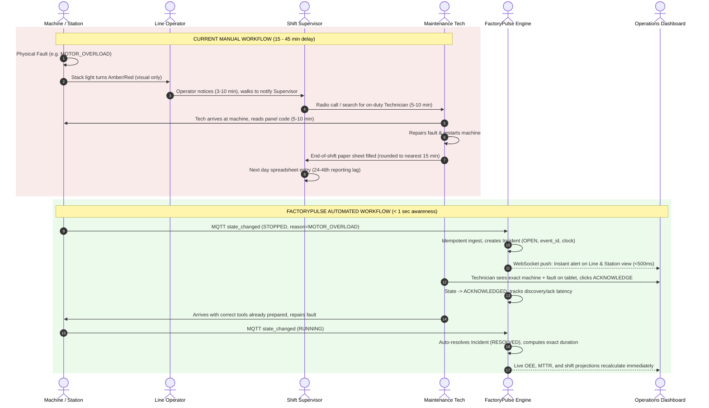

# Nova Appliances — Incident Management Workflow

> **Document Status**: Baseline Workflow Design (M2)  
> **Systems Compared**: Legacy Manual / Paper Flow vs. FactoryPulse Real-Time System

---

## 1. Context & Operational Problem

At Nova Appliances Ltd, unplanned downtime across the 3 production lines is currently tracked manually through physical paper logs, andon stack lights, and two-way radios. This introduces significant latency at every stage of an incident lifecycle:

1. **Detection Latency**: Operators often notice downtime only when a conveyor halts or a buffer runs dry.
2. **Notification Latency**: Walking to supervisor desks or finding maintenance personnel via radio.
3. **Diagnosis Latency**: Reading legacy machine panel seven-segment codes and guessing fault causes without historical telemetry.
4. **Resolution Recording Latency**: End-of-shift manual ledger completion, prone to rounding errors (e.g. "stopped ~30 min") and missing root-cause classification.

---

## 2. Workflow Comparison: Current vs. FactoryPulse

---

## 3. Detailed Lifecycle Comparison

| Lifecycle Stage | Current Baseline (Manual) | FactoryPulse Proposed (Automated) | Measurable Gain [Assumption] |
|---|---|---|---|
| **1. Fault Inception** | Machine halts; stack light flashes. | Machine halts; publishes `machine.state_changed` (`STOPPED`). | Continuous sub-second signal. |
| **2. Detection** | 3 to 10 minutes (dependent on operator alertness or buffer starvation). | `< 100 milliseconds` (instant ingestion and database registration). | Eliminates ~5–8 min blind time. |
| **3. Dispatch / Triage** | 5 to 15 minutes (in-person search, supervisor phone/radio call). | `< 30 seconds` (visual alert broadcasted via WebSocket to tablet/board). | Targeted alerting with exact `reason_code`. |
| **4. Acknowledgement** | Untracked; no formal SLA or acknowledgement timestamp. | Explicit `ACKNOWLEDGED` event recorded with technician user ID. | Enables accurate MTTA (Mean Time to Ack) metric. |
| **5. Diagnosis & Repair** | Technician inspects machine in person before fetching tools/parts. | Technician arrives knowing station, error code, and recent sensor history. | Estimated 20–30% reduction in diagnostic time. |
| **6. Machine Restart** | Machine returned to production. | Machine emits `RUNNING`; backend auto-resolves incident (`RESOLVED`). | Eliminates manual closure overhead. |
| **7. Reporting & Analytics** | 24 to 48 hours batch entry into Excel; missing short stoppages (<5m). | Live streaming metrics; OEE, MTTR, MTBF updated per minute. | 100% audit fidelity; raw event replay capability. |

---

## 4. Consequence Propagation vs Root Cause

A critical flaw in Nova's current paper logging is **secondary fault confusion**: when Machine 2 fails, Machine 1 stops due to full buffer (blocked), and Machine 3 stops due to empty buffer (starved). Operators frequently log all three machines as "down", inflating downtime counts threefold.

### FactoryPulse Handling
- **Root Cause**: Only `STOPPED` transitions spawn an `Incident` record in PostgreSQL.
- **Consequence Tracking**: `STARVED` and `BLOCKED` states carry `upstream_cause_machine_id` pointing back to Machine 2.
- **Reporting Separation**: OEE Availability treats starvation and blocking as propagation losses, while the incident board holds only the single actionable root-cause ticket for maintenance.
- **Concurrency Guard**: Enforced by a partial unique index in PostgreSQL (`WHERE status != 'RESOLVED'`), ensuring exactly **one active incident per machine** regardless of duplicate MQTT messages.

